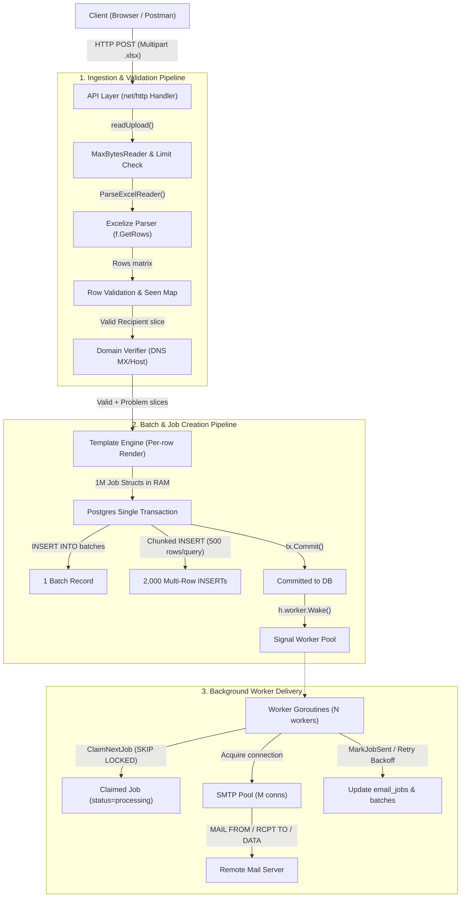
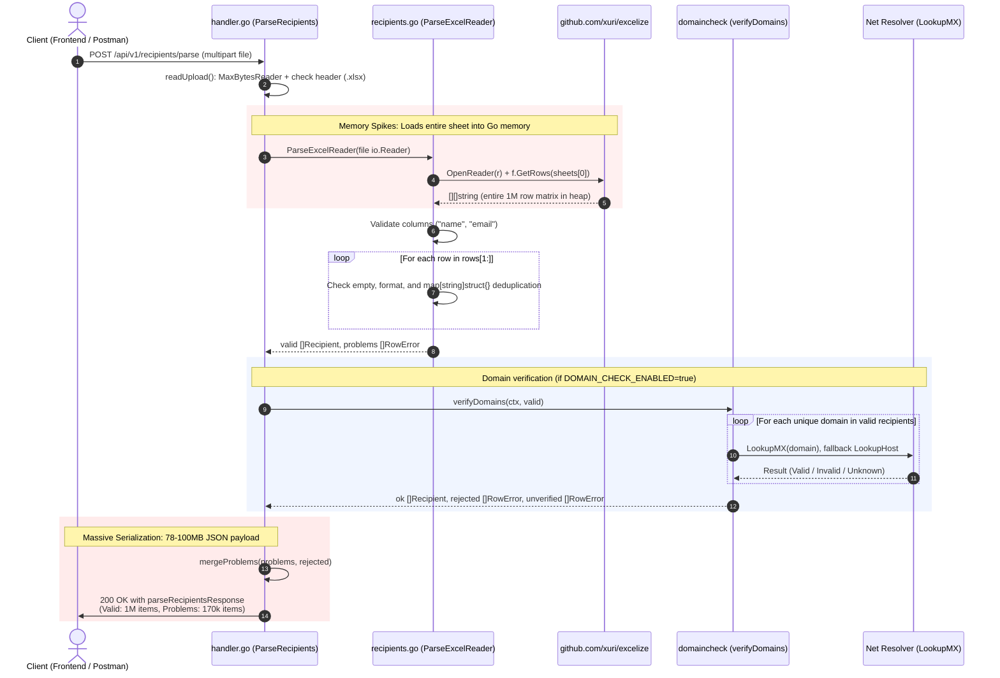
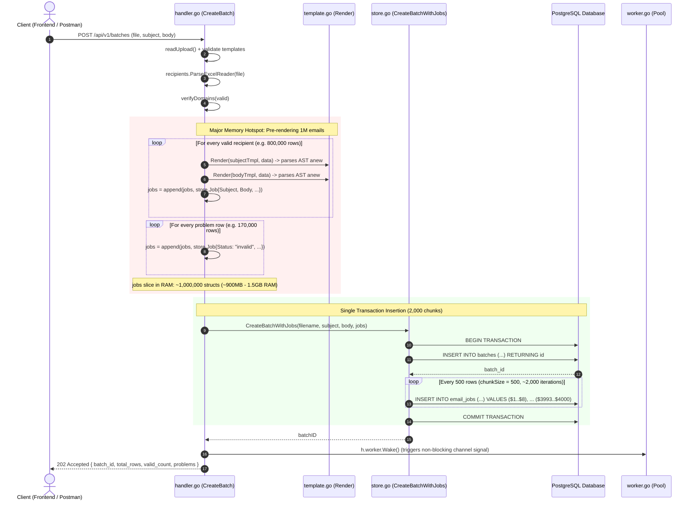
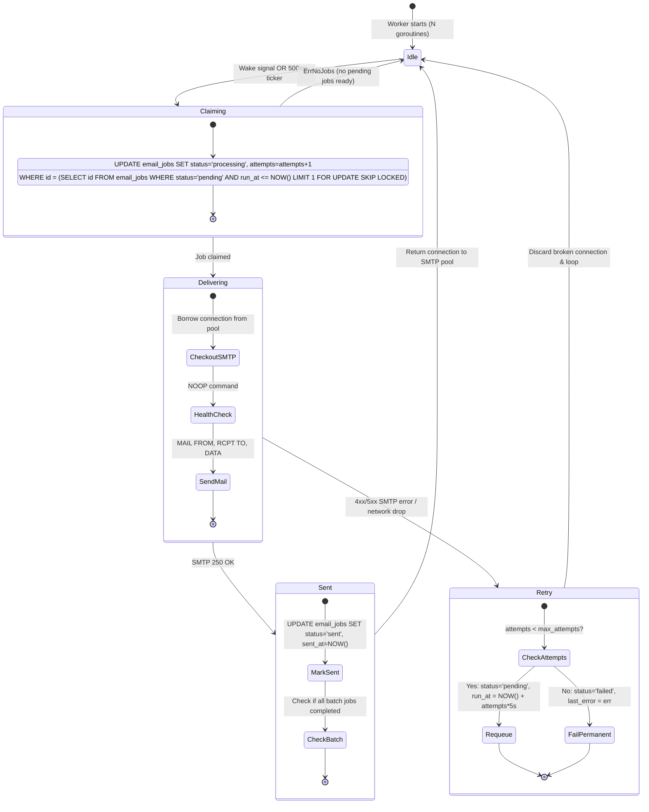

# Backend Pipeline & Lifecycle

This document details the current end-to-end lifecycle and data pipeline of the backend (`go-mail-sender`), covering request ingestion, Excel parsing, domain verification, batch creation, database chunking, and worker delivery.

---

## 1. High-Level Architecture Flow

---

## 2. Spreadsheet Parse Flow (`POST /api/v1/recipients/parse`)

This endpoint previews the spreadsheet without saving anything to the database.

### Memory Bottlenecks in Parse:
1. **`f.GetRows(sheets[0])`**: Parses uncompressed XML DOM tree into Go slices (`[][]string`), using ~233 MB - 400 MB RAM.
2. **`seen := make(map[string]struct{})`**: 1M string keys allocate ~60 MB in hash table buckets.
3. **`writeJSON(...)`**: Streams ~78 MB to 100+ MB of JSON containing all 1,000,000 recipient records.

---

## 3. Batch Ingestion Flow (`POST /api/v1/batches`)

This endpoint parses the spreadsheet, pre-renders emails, and persists the jobs into PostgreSQL.

### Memory Bottlenecks in Batch Ingestion:
1. **Template Parse Multiplier**: `template.New("email").Parse(...)` is called 2,000,000 times (twice per recipient).
2. **In-Memory Rendered Bodies**: 1,000,000 rendered strings stored in RAM simultaneously (~500 MB - 1 GB).
3. **Giant Slice**: `jobs := make([]store.Job, 0, 1M)` keeps all 1M structs (~208 bytes each) in memory until SQL commit completes.
4. **Long Transaction**: 2,000 chunk queries with 4,000 parameters each executed within a single transaction `tx`.

---

## 4. Background Delivery Worker Lifecycle

Once a batch is committed, background workers process jobs asynchronously.

