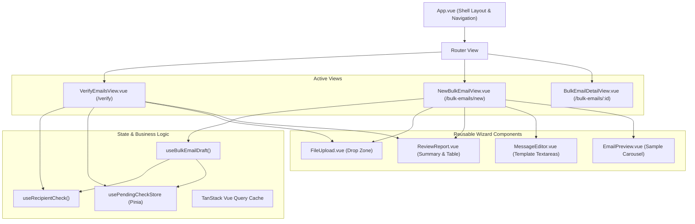
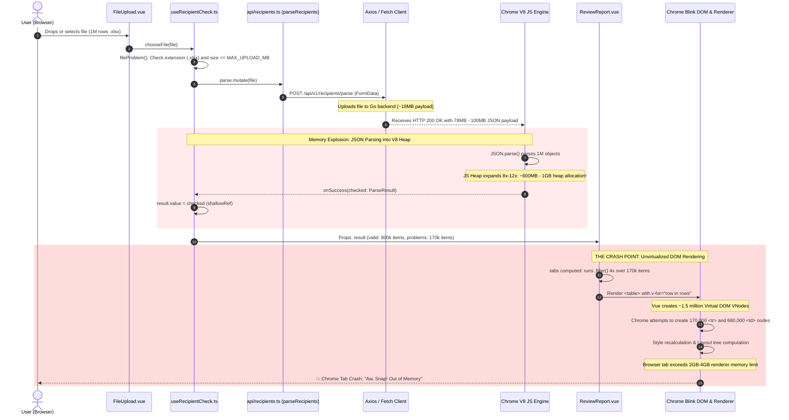
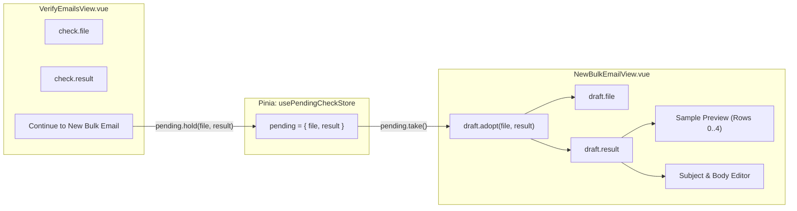
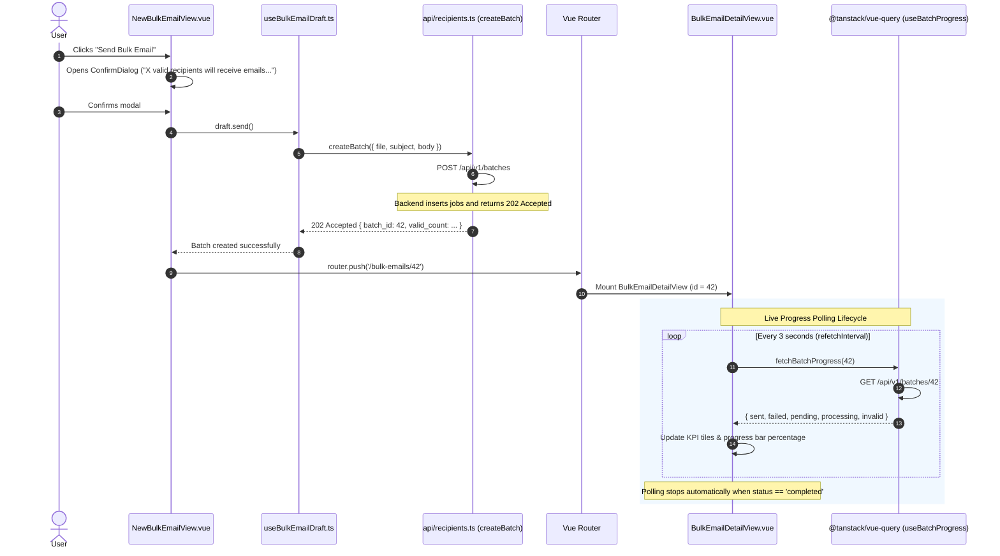
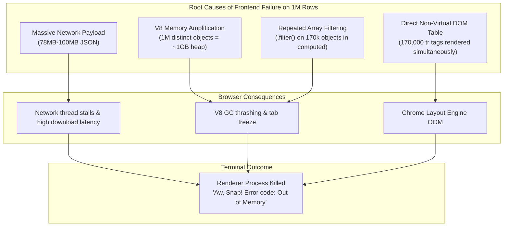

# Frontend Pipeline & Lifecycle

This document details the current component lifecycle, state management, and data flow of the frontend application (`Vue 3` + `Vite` + `Tailwind CSS` + `@tanstack/vue-query`), specifically highlighting the file upload flow and the browser memory crash path.

---

## 1. High-Level Architecture & Component Map

---

## 2. File Upload & Verification Lifecycle (`VerifyEmailsView`)

This diagram shows what happens from the moment the user selects a file until the result is rendered.

---

## 3. Data Flow Between Verify and New Bulk Email

The application allows users to verify a file and then carry the parsed result over to the bulk email creation wizard without re-uploading:

---

## 4. Batch Creation & Progress Monitoring Lifecycle

When creating a batch from `NewBulkEmailView.vue` through sending and live tracking:

---

## 5. UI Bottlenecks & Failure Summary

